<!-- SPDX-License-Identifier: AGPL-3.0-or-later -->
# Galaxia 0.7.2 → Rust Porting Specification

> **Document Version:** 1.0  
> **Source Reference:** C++ Galaxia 0.7.2 (`galaxia-0.7.2/src/`)  
> **Target Project:** `galaxia-rs`  
> **Purpose:** Provide a complete, self-contained, implementation-grade specification allowing a programmer to implement an equivalent Rust (CPU + CUDA) synthesizer without reading the C++ source.


> **Status note:** this is the design specification that was written before and during the port. It
> describes the algorithm of the C++ code and the design intentions (including GPU ones). Timing
> estimates in it are projections, not measurements: see `docs/BENCHMARK_RESULTS.md` for measured
> figures. Where it disagrees with the code or with `VALIDATION.md`, the code and `VALIDATION.md` prevail.

---

## 1. Scope & Execution Context

### 1.1 In-Scope Configuration
This specification details **strictly and exhaustively** the code path exercised by the standard configuration used by batch mode (e.g. `tests/fixtures/t.par`):

| Parameter | Value | Meaning |
|---|---|---|
| `photoSys` | `DCMC` | Photometric system (Deep Composite Magellanic/2MASS filters: I, J, H, Ks) |
| `magcolorNames` | `J,J-Ks` | Primary magnitude $m_0=J$, color $m_1 - m_2 = J - K_s$ |
| `appMagLimits` | `[-100.0, 22.0]` | Apparent magnitude cut on $J$: $-100 \le J \le 22$ |
| `absMagLimits` | `[-1000.0, 1000.0]` | Absolute magnitude cut on $J$ (wide / effectively unbounded) |
| `colorLimits` | `[-1000.0, 1000.0]` | Color cut on $J - K_s$ (wide / effectively unbounded) |
| `geometryOption`| `1` | Circular cone patch (`GPatch`) pointing at `(longitude, latitude)` |
| `surveyArea` | `0.1` | Solid angle in square degrees ($\Omega = 0.1\,\text{deg}^2$) |
| `longitude`, `latitude` | Field-dependent | Galactic longitude $l$ and latitude $b$ in degrees |
| `fSample` | `1.0` | Sampling factor (fraction of stellar mass sampled) |
| `popID` | `-1` | All 10 Milky Way populations ($0 \le \text{popID} \le 9$) |
| `warpFlareOn` | `1` | Warp and flare enabled |
| `r_max` | `1000.0` | Maximum heliocentric distance in kpc |
| `starType` | `0` | All star types (no selection of RR-Lyrae or red clumps) |
| `photoError` | `0` | No synthetic photometric noise added |
| `option` | `1` | Full execution: star generation (`option 1`) followed by magnitudes (`append1`) and extinction (`append_ext`) |
| Observer `posC` | `[-8.0, 0.0, 0.015, 11.1, 239.08, 7.25]` | Sun position $(x,y,z)=(-8, 0, 0.015)\,\text{kpc}$, $v=(11.1, 239.08, 7.25)\,\text{km/s}$ |

### 1.2 Out of Scope
The following Galaxia features are **explicitly excluded** from Phase 1:
- `popID == 10`: Bullock & Johnston N-body satellite halos (`Satellite.cpp`, `nbody1/`).
- `option == 0`: Generating BHTree octrees from analytic density models (`-s warp`).
- `starType == 1` or `2`: Dedicated RR-Lyrae or red clump color-magnitude filters.
- `photoError > 0`: Error models for LSST, SDSS, etc. (`SurveyError.cpp`).
- `fieldTableFile`: Multi-field batch reading from ASCII file (galaxia-rs implements its own high-throughput batch API).
- `addstring == "radec"`: Equatorially projected output columns.

---

## 2. Call Graph & Execution Flow

Below is the complete execution call graph for `option 1`, with file and line references matching the reference C++ source.

```mermaid
flowchart TD
    M1["main() [Galaxia.cpp:364]"] --> P1["Parameters::setFromArguments() [Parameters.cpp:326]"]
    P1 --> P2["Parameters::setFromParameterFile() [Parameters.cpp:501]"]
    M1 --> R0["Ran / Normaldev seed initialization [Galaxia.cpp:381-382]"]
    M1 --> VC["Interp vcirc(Model/vcirc.dat) [Galaxia.cpp:383]"]
    M1 --> S1["SurveyDesign sur(...) [Galaxia.cpp:415]"]
    S1 --> G1["sur.setGeometry(1, lon, lat, 0.1) [SurveyDesign.cpp:274]"]
    G1 --> GP["new GPatch(lon, lat, dth) [Geometry.h:144]"]
    M1 --> I0["IsochroneDB ic(..., read_all=0) [Galaxia.cpp:423]"]
    I0 --> IB0["IsochroneBase::readIsocrhones [IsochroneBase.cpp:184]"]
    IB0 --> CH["TableInterpolator (Chabrier dwarfs) [TableInterpolator.cpp:129]"]
    IB0 --> BC["TableInterpolatorBC (BolCorr DCMC) [TableInterpolator.h:171]"]
    M1 --> RM["runModel(sur, ic, All, vcirc) [Galaxia.cpp:290]"]
    
    subgraph Spawning ["Spawning: Loops popID 0..9"]
        RM --> SP["StellarPopulation sp(popID, ...) [StellarPopulation.cpp:14]"]
        SP --> BT["BHTree::initialize -> load(bhtree_*.ebf) [BHTree.cpp:60]"]
        BT --> BTS["std::sort(leafs by dmod) [BHTree.cpp:193]"]
        RM --> SPAWN["StellarPopulation::spawn(...) [StellarPopulation.cpp:59]"]
        SPAWN --> LF["Loop over sorted leafs [StellarPopulation.cpp:66]"]
        LF --> CS["sur.geo->checkSphere(Pos, l*1.732) [Geometry.h:151]"]
        CS --> SI["ic.setIsochrones1(...) [IsochroneDB.cpp:233]"]
        SI --> IMF_FAC["imfP->getFac(m_min, m_max) [Sampler.cpp:328]"]
        SI --> RN_LEAF["grandomu() leaf star count round [IsochroneDB.cpp:293]"]
        LF --> GEN_STAR["Loop j in 0..n_tot [StellarPopulation.cpp:99]"]
        GEN_STAR --> REJ["leaf->generatePos() rejection [BHTree.h:152]"]
        GEN_STAR --> AMR["cpop->setAgeFehMass() [Population.h:141]"]
        AMR --> RN_GAUSS["grandomn() [Functions.h:129]"]
        AMR --> IMF_RND["imfP->rand() [Sampler.cpp:334]"]
        GEN_STAR --> INTP["ic.interpolateStar() [IsochroneDB.cpp:302]"]
        GEN_STAR --> VEL["cpop->setVel() [Population.cpp:117]"]
        VEL --> RN_V["grandomn() x3 [Population.cpp:125-127]"]
        GEN_STAR --> APP["Star.AbsToAppMag() [StarParticle.h:69]"]
        GEN_STAR --> PUSH["sur.push_back(Star) [SurveyDesign.cpp:88]"]
        PUSH --> CUT["sur.checkColMag() [SurveyDesign.cpp:328]"]
        PUSH --> CP["sur.geo->checkP() [Geometry.h:163]"]
        PUSH --> BUF["Buffer into Stars vector [SurveyDesign.cpp:101]"]
        RM --> FLUSH["sur.flush() [SurveyDesign.cpp:159]"]
    end
    
    RM --> CLOSE["sur.close() [SurveyDesign.cpp:175]"]
    CLOSE --> SAVE_TMP["Save temporary .tmp0..17 to output.ebf [SurveyDesign.cpp:239]"]
    
    M1 --> APP1["append1(output.ebf, ic_all, ...) [Galaxia.cpp:142]"]
    APP1 --> I1["IsochroneDB ic(..., read_all=1) [Galaxia.cpp:520]"]
    APP1 --> ITGM["ic.interpolateTGM() [IsochroneDB.cpp:344]"]
    APP1 --> SAVE_MAGS["Append /lum, /teff, /grav, /mact, /dcmc_* [Galaxia.cpp:186-213]"]
    
    M1 --> APP_EXT["append_ext(output, dataDir) [Galaxia.cpp:37]"]
    APP_EXT --> G3D["gi.readFromFile(ExMap3d_1024.ebf, /ExMap3d) [Galaxia.cpp:44]"]
    APP_EXT --> G2S["ge_solar.readFromFile(ExMap3d_1024.ebf, /ExMap2d) [Galaxia.cpp:46]"]
    APP_EXT --> G2SCH["ge_schlegel.readFromFile(Schlegel_4096.ebf, /ExMap2d) [Galaxia.cpp:48]"]
    APP_EXT --> EXT_LOOP["Loop stars: Cot::xyz_to_lbr + interpol [Galaxia.cpp:60-77]"]
    APP_EXT --> EXT_WRITE["Append /ExBV_Solar, /ExBV_Schlegel, /glon, /glat [Galaxia.cpp:84-89]"]
```



---

## 3. Data Files & Memory Layouts

All path references originate relative to `CODEDATAPATH` (the `GalaxiaData/` directory of the original distribution).

### 3.1 BHTree Octrees (`BHTree-2.2/bhtree_with_wf/`)
There are 10 binary EBF files, one per population tree:
- Filename pattern: `bhtree_{popID}_E1.ebf` for $\text{popID} \in [0, 6]$ (`optionE=1`), and `bhtree_{popID}_E0.ebf` for $\text{popID} \in [7, 9]$ (`optionE=0`).
- File Format: EBF Version 1.1.
- Internal Datasets:
  1. `/Nodes`: `float64` array of shape `(N_nodes, 12)`.
     - `Pos[0..3]`: Galactocentric coordinates $x, y, z$ in kpc, and age in yr (column 0, 1, 2, 3).
     - `l`: Half-box side length in kpc (column 4).
     - `mass`: Integrated stellar mass of node in $M_\odot$ (column 5).
     - `delta_mass`: Mass error estimate (column 6).
     - `rho_max`: Maximum density within node in $M_\odot / \text{kpc}^3$ (column 7).
     - `rho_min`: Minimum density within node in $M_\odot / \text{kpc}^3$ (column 8).
     - `dmod`: Distance modulus from observer (column 9, initialized to 0 on disk).
     - `lage`: Age half-width (column 10).
     - `left`: Pointer offset stored as `int64_t` bit-cast to double `*(int64_t*)&x[11]` (column 11). $-1$ indicates a leaf node; $\ge 0$ gives the node index of the first of 8 octants.
  2. `/Leafs`: `int64` array of shape `(N_leafs,)`. Indices into the `/Nodes` array identifying all leaf nodes.
- What is kept in memory:
  - Vector of `BHNode` structures (`rootv`) of length `N_nodes`.
  - Vector of pointers `BHNode*` (`leafs`) of length `N_leafs`.
  - At runtime, `dmod` is populated for each leaf via `leaf->calculateDmod(posC)`, and `leafs` is sorted in ascending order of `dmod`.

### 3.2 Circular Velocity Curve (`Model/vcirc.dat`)
- File Format: Plain text ASCII.
- Contents:
  - Line 1: integer count $N = 300$.
  - Next $N$ values: Galactocentric radial distance grid $R$ in kpc (from $0.1\,\text{kpc}$ to $252.5\,\text{kpc}$).
  - Next $N$ values: Circular velocity $v_{\text{circ}}(R)$ in $\text{km/s}$ (from $\sim 54.5\,\text{km/s}$ to $\sim 230\,\text{km/s}$).
  - Trailing value: $0.0$.
- Kept in memory: Two `std::vector<double>` arrays of length 300 in `Interp vcirc`.

### 3.3 Radial Surface Density Tables (`Model/surface_density.ebf`)
- File Format: EBF Version 1.0.
- Datasets:
  - `/surface_density1.data`: `float32`, shape `(100,)`, radial surface density for ThinDisk0.
  - `/surface_density1.xmms`: `float32`, shape `(3,)` = `[0.0, 30.0, 0.3030303]`. (min, max, step size).
  - `/surface_density2.data`: `float32`, shape `(100,)`, radial surface density for ThinDisk1..6.
  - `/surface_density2.xmms`: `float32`, shape `(3,)` = `[0.0, 30.0, 0.3030303]`.
- Kept in memory: Flattened `vector<float>` data and grid metadata within `GInterpolator`.

### 3.4 Padova Isochrones (`Isochrones/padova/DCMC/`)
- Directory structure:
  - `IsoFileDescriptor.txt`: Text line: `DCMC 17 7 4 I J H Ks`
    - `photoSys = "DCMC"`, `fields = 17` total columns.
    - `startid = 7`, `nmags1 = 4` magnitude bands: `I` (col 7), `J` (col 8), `H` (col 9), `Ks` (col 10).
  - 34 metallicity files: `output_0.000100.dat` to `output_0.030000.dat`.
    $Z \in [0.0001, 0.0002, 0.0004, 0.0005, 0.0006, 0.0007, 0.0008, 0.0009, 0.0010, 0.0012, 0.0014, 0.0016, 0.0018, 0.0020, 0.0022, 0.0024, 0.0026, 0.0030, 0.0034, 0.0040, 0.0050, 0.0060, 0.0070, 0.0080, 0.0090, 0.0100, 0.0120, 0.0140, 0.0160, 0.0180, 0.0200, 0.0240, 0.0280, 0.0300]$.
    Metallicity conversion: $[\text{Fe/H}] = \log_{10}(Z / 0.019)$.
- Format: ASCII space-separated tables.
  Columns:
  1. `log(age/yr)` ($\log_{10}(\text{age})$)
  2. `M_ini` (initial mass $M_\odot$)
  3. `M_act` (actual/current mass $M_\odot$)
  4. `logL/Lo` ($\log_{10}(L/L_\odot)$)
  5. `logTe` ($\log_{10}(T_{\text{eff}}/\text{K})$)
  6. `logG` ($\log_{10}(g / (\text{cm/s}^2))$)
  7. `mbol` (bolometric magnitude)
  8..11. Magnitudes: `I`, `J`, `H`, `Ks`
  12..16. Unused stellar evolution properties (`C/O`, `M_hec`, `period`, `pmode`, `logMdot`, `int_IMF`).
- Age grid: 182 ages per $Z$ file, starting at $\log_{10}(\text{age}) = 6.60$ up to $10.22$ ($\Delta \log_{10}(\text{age}) = 0.02$).
- Total tracks: $182 \times 34 = 6,188$ isochrone tracks.
- Total raw mass points per track: $\approx 144$. With 15 appended Chabrier dwarfs: $\approx 159$ points.

### 3.5 Very Low Mass Star Models (`Isochrones/Chabrier/` & `Isochrones/BolCorr/DCMC/`)
Used to patch isochrones below $0.15\,M_\odot$:
- `Chabrier/`:
  - `interp_keys.txt`: 5 age files (`age0.1.dat`, `age0.5.dat`, `age1.0.dat`, `age5.0.dat`, `age10.0.dat`), `keys = [8.0, 8.69897, 9.0, 9.69897, 10.0]` ($\log_{10}(\text{age})$).
  - Each file tabulates mass vs $T_{\text{eff}}$, $L/L_\odot$, $\log g$.
- `BolCorr/DCMC/`:
  - `interp_keys.txt`: 7 files (`bctab_m25n.dat`..`bctab_p05n.dat`), `keys = [-2.5, -2.0, -1.5, -1.0, -0.5, 0.0, 0.5]` ($[\text{Fe/H}]$).
  - `teff_list.dat`: 81 temperature bins.
  - Tabulates bolometric corrections for each photometric filter.

### 3.6 Extinction Maps (`Extinction/`)
- `ExMap3d_1024.ebf` (EBF Ver 1.0):
  - `/ExMap3d.data`: `float32`, shape `(1024, 1024, 100)` ($419.43\,\text{MB}$). 3D relative extinction scale factor $f_{\text{ext}}(l, b, \log_{10}(d))$.
  - `/ExMap3d.xmms`: `float32`, shape `(3, 3)`:
    - Dim 0 ($l$): $[0.0^\circ, 360.0^\circ, 0.35190615^\circ]$
    - Dim 1 ($b$): $[-90.0^\circ, +90.0^\circ, 0.17595308^\circ]$
    - Dim 2 ($\log_{10}(d/\text{kpc})$): $[-2.0, 1.4771212, 0.035122439]$ ($10\,\text{pc}$ to $30\,\text{kpc}$).
  - `/ExMap2d.data`: `float32`, shape `(1024, 1024)` ($4.19\,\text{MB}$). Solar normalization map $E(B-V)_{\odot,\infty}(l, b)$.
  - `/ExMap2d.xmms`: `float32`, shape `(2, 3)`:
    - Dim 0 ($l$): $[0.0^\circ, 360.0^\circ, 0.35190615^\circ]$
    - Dim 1 ($b$): $[-90.0^\circ, +90.0^\circ, 0.17595308^\circ]$
- `Schlegel_4096.ebf` (EBF Ver 1.0):
  - `/ExMap2d.data`: `float32`, shape `(4096, 4096)` ($67.11\,\text{MB}$). SFD98 full asymptotic extinction $E(B-V)_{\text{SFD},\infty}(l, b)$.
  - `/ExMap2d.xmms`: `float32`, shape `(2, 3)`:
    - Dim 0 ($l$): $[0.0^\circ, 360.0^\circ, 0.08791209^\circ]$
    - Dim 1 ($b$): $[-90.0^\circ, +90.0^\circ, 0.043956045^\circ]$

---

## 4. Core Data Structures & Classes

### 4.1 `BHNode` (Octree Node / Leaf)
```cpp
class BHNode {
    double Pos[4];     // Pos[0..2] = (x, y, z) in kpc; Pos[3] = age in yr
    double l;          // Half-side box width (kpc)
    double mass;       // Stellar mass (M_sun)
    double delta_mass; // Relative mass error
    double rho_max;    // Peak density within bounding box (M_sun / kpc^3)
    double rho_min;    // Minimum density within bounding box (M_sun / kpc^3)
    double dmod;       // Distance modulus = 5 * log10(dist_kpc * 100.0)
    double lage;       // Half-width in age (yr)
    BHNode* left;      // Pointer to first child (NULL for leaf)
};
```

### 4.2 `Isochrone` (Single Age-Metallicity Track)
```cpp
class Isochrone {
    double age;                   // log10(age/yr)
    double FeH;                   // [Fe/H] = log10(Z / 0.019)
    double alpha;                 // [alpha/Fe] (0.0 for Padova)
    vector<double> m;             // Initial mass array (M_sun), strictly ascending
    vector<double> Mact;          // Actual mass array (M_sun)
    vector<double> Mag0;          // Primary abs magnitude (J)
    vector<double> Mag1;          // Secondary abs magnitude (J)
    vector<double> Mag2;          // Color second magnitude (Ks)
    vector<double> Teff;          // log10(Teff)
    vector<double> Grav;          // log10(g)
    vector<double> Lum;           // log10(L/Lsun)
    vector<vector<double>> Mags;  // Extra filter mags [I, J, H, Ks] (append1 only)
    vector<double> Vmon;          // Monotonically decreasing envelope of Mag0
    double m_min, m_max;          // Active mass range under current maxV
    double maxV;                  // Current limiting absolute magnitude
    double mtip;                  // Mass at RGB tip
};
```

### 4.3 `Population` Hierarchy & Exact Constants

Base parameters common to all populations:
- $R_\odot = 8.0\,\text{kpc}$, $z_\odot = 0.015\,\text{kpc}$.
- Solar velocity: $v_\odot = [11.1, 239.08, 7.25]\,\text{km/s}$.
- $v_{\text{const}} = 226.84\,\text{km/s}$.

#### Population Subclasses & Numeric Table

| Pop ID | Class | `optionE` | Age (Gyr) | $\Delta\text{Age}$ (Gyr) | $[\text{Fe/H}]$ | $\sigma_{[\text{Fe/H}]}$ | $\epsilon$ (scale height ratio) | $\sigma_U, \sigma_V, \sigma_W$ (km/s) | IMF Function |
|---|---|---|---|---|---|---|---|---|---|
| **0** | `ThinDisk0` | 1 | 0.075 | 0.075 | +0.01 | 0.12 | 0.014 | $50.0, 32.2997, 21.0084$ | `exp_imf0` |
| **1** | `ThinDisk1` | 1 | 0.575 | 0.425 | +0.03 | 0.12 | 0.0268 | $50.0, 32.2997, 21.0084$ | `exp_imf0` |
| **2** | `ThinDisk1` | 1 | 1.500 | 0.500 | +0.03 | 0.10 | 0.0375 | $50.0, 32.2997, 21.0084$ | `exp_imf0` |
| **3** | `ThinDisk1` | 1 | 2.500 | 0.500 | +0.01 | 0.11 | 0.0551 | $50.0, 32.2997, 21.0084$ | `exp_imf0` |
| **4** | `ThinDisk1` | 1 | 4.000 | 1.000 | -0.07 | 0.18 | 0.0696 | $50.0, 32.2997, 21.0084$ | `exp_imf0` |
| **5** | `ThinDisk1` | 1 | 6.000 | 1.000 | -0.14 | 0.17 | 0.0785 | $50.0, 32.2997, 21.0084$ | `exp_imf0` |
| **6** | `ThinDisk1` | 1 | 8.500 | 1.500 | -0.37 | 0.20 | 0.0791 | $50.0, 32.2997, 21.0084$ | `exp_imf0` |
| **7** | `ThickDisk` | 0 | 11.00 | 0.000 | -0.78 | 0.30 | 0.0000 | $67.0, 51.0000, 42.0000$ | `exp_imf7` |
| **8** | `Spheroid` | 0 | 14.00 | 0.000 | -1.78 | 0.50 | 0.7600 | $135.0, 85.000, 85.0000$ | `exp_imf8` |
| **9** | `Bulge` | 0 | 10.00 | 0.000 | 0.00 | 0.40 | 0.0000 | $110.0, 110.00, 100.0000$ | `exp_imf9` |

### 4.4 `StarParticle` Structure
Stored internally as a `double Pos[21]` array:
- `Pos[0..2]`: Position $(x, y, z)$ (kpc). Galactocentric in leaf generator, shifted to Heliocentric in `sur.push_back`.
- `Pos[3..5]`: Velocity $(v_x, v_y, v_z)$ (km/s).
- `Pos[6]`: Metallicity $[\text{Fe/H}]$.
- `Pos[7]`: $[\alpha/\text{Fe}]$ (copied from $[\text{Fe/H}]$ for standard populations).
- `Pos[8]`: Age stored as $\log_{10}(\text{age}/\text{yr})$.
- `Pos[9]`: Stellar mass $m$ ($M_\odot$).
- `Pos[10]`: Heliocentric distance $r = \sqrt{x^2 + y^2 + z^2}$ (kpc).
- `Pos[11..13]`: Absolute magnitudes $M_{\text{band}0}, M_{\text{band}1}, M_{\text{band}2}$, converted to apparent magnitudes via `+ dmod` in `AbsToAppMag()`.
- `Pos[14]`: $\log_{10}(L/L_\odot)$.
- `Pos[15]`: $\log_{10}(T_{\text{eff}}/\text{K})$.
- `Pos[16]`: $\log_{10}(g / (\text{cm/s}^2))$.
- `Pos[17]`: Distance modulus $\mu = 5 \log_{10}(r \cdot 100.0)$.
- `Pos[18]`: `satID` (`int64_t`, $0$ for Milky Way).
- `Pos[19]`: `popID` (`int64_t`, $0..9$).
- `Pos[20]`: `partID` (`int64_t`, $0$).

When written to the survey buffer, `StarParticle` is converted to `StarParticlef` (14 `float32`s + 3 `int32`s).

---

## 5. Per-Function Semantics & Exact Formulas

### 5.1 Warp and Flare Transformation
Used by `ThinDisk` (0..6) and `ThickDisk` (7):
- Cylindrical Galactocentric radius and azimuth:
  $$R = \sqrt{x^2 + y^2}, \quad \theta = \text{atan2}(y, x)$$
  $$\text{if } \theta < 0: \quad \theta \leftarrow \theta + 2\pi$$
- Warp constants:
  $$\theta_{\max} = \frac{\pi}{2}, \quad \gamma_{\text{warp}} = 0.18$$
  $$R_{\text{warp}} = \begin{cases} 8.4 \times \frac{R_\odot}{8.5} = 7.90588235\,\text{kpc} & \text{(ThinDisk 0..6)} \\ 8.51 \times \frac{R_\odot}{8.5} = 8.00941176\,\text{kpc} & \text{(ThickDisk 7)} \end{cases}$$
- Flare constants:
  $$\gamma_{\text{flare}} = 5.4 \times 10^{-4}, \quad R_{\text{flare}} = 9.5 \times \frac{R_\odot}{8.5} = 8.94117647\,\text{kpc}$$
- Transformed coordinate $z_{\text{warp}}$ and flare factor $k_{\text{flare}}$:
  $$z_{\text{warp}} = \begin{cases} z - \gamma_{\text{warp}} (R - R_{\text{warp}}) \cos(\theta - \theta_{\max}) & \text{if } R > R_{\text{warp}} \\ z & \text{otherwise} \end{cases}$$
  $$k_{\text{flare}} = \begin{cases} 1 + \gamma_{\text{flare}} (R - R_{\text{flare}}) & \text{if } R > R_{\text{flare}} \\ 1.0 & \text{otherwise} \end{cases}$$

### 5.2 Analytic Stellar Density Laws $\rho(x, y, z, \text{age})$

#### 1. ThinDisk0 (Pop ID 0, $0 \le \text{age} \le 0.15\,\text{Gyr}$)
- Effective scale height:
  $$\epsilon(\text{age}) = \min\left(0.079, 0.104 \left(\frac{\text{age} + 0.1 \times 10^9}{10.1 \times 10^9}\right)^{0.5}\right)$$
- Scaled radial/vertical distance squared:
  $$a^2 = x^2 + y^2 + \frac{z_{\text{warp}}^2}{\epsilon(\text{age})^2 \cdot k_{\text{flare}}^2}$$
- Radial scale lengths: $h_{r1}^2 = 25.0\,\text{kpc}^2$, $h_{r2}^2 = 9.0\,\text{kpc}^2$.
- Normalization:
  $$\rho_0 = \frac{\text{SFR}}{5.5683282 \times (5^3 - 3^3)} = \frac{2.37}{5.5683282 \times 98} = 4.3430758 \times 10^{-3}\,M_\odot/\text{kpc}^3$$
- Density:
  $$\rho(x, y, z, \text{age}) = \frac{\rho_0}{\epsilon(\text{age})} \cdot \frac{\exp(-a^2 / 25.0) - \exp(-a^2 / 9.0)}{k_{\text{flare}}}$$

#### 2. ThinDisk1..6 (Pop IDs 1..6, $0.15 < \text{age} \le 10.0\,\text{Gyr}$)
- Radial scale lengths: $h_{r1}^2 = (2.530)^2 = 6.4009\,\text{kpc}^2$, $h_{r2}^2 = (1.320)^2 = 1.7424\,\text{kpc}^2$.
- Normalization:
  $$\rho_0 = \frac{\text{SFR}}{23.719602 \times (2.530^3 - 1.320^3)} = \frac{2.37}{329.567602} = 7.1912408 \times 10^{-3}\,M_\odot/\text{kpc}^3$$
  *(For popID 6, $\rho_0$ is divided by $1.25$)*.
- Scaled distance squared $a^2$ computed identically to ThinDisk0.
- Density:
  $$\rho(x, y, z, \text{age}) = \frac{\rho_0}{\epsilon(\text{age})} \cdot \frac{\exp(-\sqrt{0.25 + a^2 / 6.4009}) - \exp(-\sqrt{0.25 + a^2 / 1.7424})}{k_{\text{flare}}}$$

#### 3. ThickDisk (Pop ID 7)
- Constants: $h_{r1} = 2.5\,\text{kpc}$, $h_{r2} = 0.8\,\text{kpc}$, $x_l = 0.4\,\text{kpc}$.
- Flare adjustment factor:
  $$\text{temp} = \frac{(2 h_{r2} + x_l)(3 k_{\text{flare}} h_{r2} x_l + 3 k_{\text{flare}}^2 h_{r2}^2 + x_l^2)}{(2 h_{r2} k_{\text{flare}} + x_l)(3 h_{r2} x_l + 3 h_{r2}^2 + x_l^2)}$$
- Planar radius: $R = \sqrt{x^2 + y^2}$.
- Density formula:
  $$\text{If } |z| < x_l: \quad \rho = \rho_0 \exp\left(-\frac{R - R_\odot}{h_{r1}}\right) \left(1 - \frac{z_{\text{warp}}^2}{x_l (2 h_{r2} k_{\text{flare}} + x_l)}\right) \frac{1}{\text{temp}}$$
  $$\text{If } |z| \ge x_l: \quad \rho = \rho_0 \exp\left(-\frac{R - R_\odot}{h_{r1}}\right) \left(\frac{\exp(x_l / (h_{r2} k_{\text{flare}}))}{1 + 0.5 x_l / (h_{r2} k_{\text{flare}})}\right) \frac{\exp(-|z_{\text{warp}}| / (h_{r2} k_{\text{flare}}))}{\text{temp}}$$
  *(Note the quirk: condition tests unwarped $|z|$, but evaluated expression uses warped $z_{\text{warp}}$)*.
  $\rho_0$ is normalized such that $\rho(\text{posC}) = 1.34 \times 10^6 \times 1157.68$.

#### 4. Spheroid (Pop ID 8, Stellar Halo)
- Constants: $a_c = 0.5\,\text{kpc}$, $\epsilon = 0.76$, exponent $\alpha = -2.44$.
- Ellipsoidal radius:
  $$a = \sqrt{x^2 + y^2 + \frac{z^2}{\epsilon^2}}$$
- Density:
  $$\rho = \begin{cases} \rho_c = \rho_0 \left(\frac{a_c}{R_\odot}\right)^{-2.44} & \text{if } a < a_c \\ \rho_0 \left(\frac{a}{R_\odot}\right)^{-2.44} & \text{if } a \ge a_c \end{cases}$$
  $\rho_0$ is normalized such that $\rho(\text{posC}) = 9.32 \times 10^3 \times 1407.52 \times 1.1$.

#### 5. Bulge (Pop ID 9)
- Triaxial rotation matrix $\mathbf{TM}$ with Euler angles $\alpha = 78.9^\circ, \beta = 3.5^\circ, \gamma = 91.3^\circ$:
  $$\mathbf{TM} = \mathbf{R}_x(\gamma) \cdot \mathbf{R}_y(-\beta) \cdot \mathbf{R}_z(\alpha - 90^\circ)$$
- Transformed coordinates: $\mathbf{r}_{\text{bulge}} = \mathbf{TM} \cdot \mathbf{r}$.
- Scale lengths: $x_0 = 1.59\,\text{kpc}$, $y_0 = 0.424\,\text{kpc}$, $z_0 = 0.424\,\text{kpc}$, cut radius $R_c = 2.54\,\text{kpc}$.
- Normalized radius:
  $$a_2 = \sqrt{\left(\frac{x_{\text{bulge}}^2}{x_0^2} + \frac{y_{\text{bulge}}^2}{y_0^2}\right)^2 + \left(\frac{z_{\text{bulge}}^2}{z_0^2}\right)^2}$$
- Cutoff factor: $t = \sqrt{x_{\text{bulge}}^2 + y_{\text{bulge}}^2} - R_c$.
- Density ($\rho_0 = 0.255 \times 13.7 \times 10^9$):
  $$\rho = \begin{cases} \rho_0 \exp(-0.5 a_2) & \text{if } t < 0 \\ \rho_0 \exp(-0.5 a_2) \exp(-t^2 / 0.5) & \text{if } t \ge 0 \end{cases}$$

---

### 5.3 Initial Mass Function (`Sampler`)
1. **Forms:**
   - ThinDisk 0..6:
     $$\xi(m) = \begin{cases} m^{-1.6} & \text{if } m < 1.0 \\ m^{-3.0} & \text{if } m \ge 1.0 \end{cases}$$
   - ThickDisk 7 & Spheroid 8:
     $$\xi(m) = m^{-0.5}$$
   - Bulge 9:
     $$\xi(m) = m^{-2.35}$$
2. **Cumulative Probability Distribution $C(m)$:**
   Discretized on 10,000 log-spaced mass bins between $m_{\min} = 0.07$ and $m_{\max} = 100.0$.
   Since $\xi(m_{\min}) > \xi(m_{\max})$, integration runs **backwards** from $m_{\max}$ down to $m_{\min}$:
   $$C(m_{\max}) = 0.0, \quad C(m_i) = C(m_{i+1}) + \frac{1}{2}(m_{i+1} - m_i)(\xi(m_{i+1}) + \xi(m_i))$$
   Normalized so $C(m_{\min}) = 1.0$.
3. **`getFac(m1, m2)`:**
   $$F(m_1, m_2) = |C(m_1) - C(m_2)|$$
4. **`rand()`:**
   Given active range $[m_{\text{box},\min}, m_{\text{box},\max}]$, linearly interpolate $C(m)$ to obtain $C_{\min}$ and $C_{\max}$.
   Draw uniform $u \sim \mathcal{U}(C_{\min}, C_{\max})$.
   Locate interval in $C$ using `upper_bound(..., greater<double>())` and linearly interpolate to obtain stellar mass $m$.

---

### 5.4 Leaf Bounding & Stellar Count (`setIsochrones1`)
1. **Geometric Cone Pre-filter (`checkSphere`):**
   - Heliocentric leaf vector: $\mathbf{r}_{\text{helio}} = \mathbf{r}_{\text{leaf}} - \mathbf{r}_\odot$.
   - Radius $r = \|\mathbf{r}_{\text{helio}}\|$.
   - Bounding sphere radius: $h = l_{\text{leaf}} \times \sqrt{3} \approx 1.73205 \times l_{\text{leaf}}$.
   - Closest approach: $r_c = r - h$.
   - Leaf rejected if $r_c \ge r_{\max}$ or if $\arccos\left(\frac{\mathbf{r}_{\text{helio}} \cdot \mathbf{u}_{\text{cone}}}{r}\right) - \arcsin\left(\frac{h}{r}\right) \ge \theta_{\text{cone}}$.
2. **Age & Metallicity Probabilities:**
   - In-plane radius: $R_c = \sqrt{x_{\text{leaf}}^2 + y_{\text{leaf}}^2}$.
   - Radial metallicity gradient:
     $$\text{feh}_{\text{temp}} = \begin{cases} [\text{Fe/H}]_{\text{pop}} - 0.07 (R_c - R_\odot) & \text{if } \text{popID} < 7 \\ [\text{Fe/H}]_{\text{pop}} & \text{if } \text{popID} \ge 7 \end{cases}$$
   - $W_{\text{Age}}$: For $\Delta\text{Age} = 0$, $W_{\text{Age}}[i] = 1 - \frac{\text{age} - \text{Age}[i]}{\text{Age}[i+1] - \text{Age}[i]}$. For $\Delta\text{Age} > 0$, integrated top-hat.
   - $W_{\text{FeH}}$: Gaussian CDF difference over grid intervals:
     $$W_{\text{FeH}}[q] = \frac{1}{2}\left[\text{erfc}\left(-\frac{t_{\text{hi}}}{\sqrt{2}}\right) - \text{erfc}\left(-\frac{t_{\text{lo}}}{\sqrt{2}}\right)\right]$$
3. **Mass Window $[m_{\text{box},\min}, m_{\text{box},\max}]$:**
   - For all active $(p, q)$ where $W_{\text{Age}}[p] > 0$ and $W_{\text{FeH}}[q] > 0$:
     Evaluate $m_{\min}(M_{\max})$ on each isochrone track with $M_{\max} = \min(M_{\text{abs,max}}, m_{\text{app,max}} - \mu_{\text{leaf}})$.
     Take bounding envelope:
     $$m_{\text{box},\min} = \max(m_{\text{imf},\min}, \min_{(p,q)} m_{\min}), \quad m_{\text{box},\max} = \max_{(p,q)} m_{\max}$$
4. **Poisson/Stochastic Star Count $N_{\text{tot}}$:**
   $$\mu_{\text{stars}} = M_{\text{leaf}} \cdot f_{\text{sample}} \cdot \frac{F(m_{\text{box},\min}, m_{\text{box},\max})}{\bar{m}_{\text{IMF}}}$$
   $$N_{\text{tot}} = \lfloor \mu_{\text{stars}} \rfloor + \begin{cases} 1 & \text{if } \mathcal{U}(0, 1) < (\mu_{\text{stars}} - \lfloor \mu_{\text{stars}} \rfloor) \\ 0 & \text{otherwise} \end{cases}$$
5. **Contrast Quirk:**
   $$\text{If } N_{\text{tot}} == 1 \text{ and } M_{\text{leaf}} < 0.01\,M_\odot \text{ and } \frac{\rho_{\max}}{\rho_{\min}} > 250.0: \quad N_{\text{tot}} \leftarrow 0$$

---

### 5.5 Star Generation Inside Leaf
For each star $j \in [0, N_{\text{tot}} - 1]$:
1. **Position Rejection Sampling (`generatePos`):**
   Loop until accepted:
   $$x = x_{\text{leaf}} + (u_1 - 0.5) \cdot 2 l_{\text{leaf}}$$
   $$y = y_{\text{leaf}} + (u_2 - 0.5) \cdot 2 l_{\text{leaf}}$$
   $$z = z_{\text{leaf}} + (u_3 - 0.5) \cdot 2 l_{\text{leaf}}$$
   $$\text{if optionE == 1}: \quad \text{age} = \text{age}_{\text{leaf}} + (u_4 - 0.5) \cdot 2 l_{\text{age}}$$
   Evaluate $\rho = \rho(x, y, z, \text{age})$.
   Draw $u_5 \sim \mathcal{U}(0, 1)$.
   Accept if $u_5 \cdot (2.0 \rho_{\max}) \le \rho$.
2. **Age, Metallicity, Mass Assignment (`setAgeFehMass`):**
   - If `optionE == 0`: $\text{age} = \text{age}_{\text{pop}} + (u_6 - 0.5) \cdot 2 \Delta\text{age}$.
   - $[\text{Fe/H}] = \text{AMR}(x, y, z, \text{age}) + Z_0 \cdot \sigma_{[\text{Fe/H}]}$ where $Z_0 \sim \mathcal{N}(0, 1)$.
   - Stellar mass $m \sim \text{imfP->rand()}$ within $[m_{\text{box},\min}, m_{\text{box},\max}]$.
   - $\text{age} \leftarrow \log_{10}(\text{age})$.
3. **Isochrone Lookup (`interpolateStar`):**
   - Find nearest Age index: $i = \lfloor (\log_{10}(\text{age}) - \text{Age}[0]) / \Delta\text{Age} + 0.5 \rfloor$.
   - Find nearest $[\text{Fe/H}]$ index: $j = \text{locate\_nearest}(\text{FeH}, [\text{Fe/H}])$.
   - In track $\text{icv}[j \cdot N_{\text{ages}} + i]$, interpolate between mass table entries $m_k \le m < m_{k+1}$ to obtain $M_J, M_{Ks}$.
4. **Velocity Generation (`setVel`, consumed if $M_J < 10^4$):**
   - Three standard normal deviates $Z_1, Z_2, Z_3 \sim \mathcal{N}(0, 1)$.
   - Velocity dispersions $\sigma_U, \sigma_V, \sigma_W$ applied with circular velocity $v_c(R)$ and asymmetric drift.
5. **Apparent Magnitude & Survey Cuts:**
   - Heliocentric position: $\mathbf{r}_{\text{helio}} = \mathbf{r} - \mathbf{r}_\odot$.
   - Heliocentric distance: $r = \|\mathbf{r}_{\text{helio}}\|$.
   - Distance modulus: $\mu = 5 \log_{10}(r \cdot 100.0)$.
   - Apparent magnitudes: $J = M_J + \mu$, $K_s = M_{Ks} + \mu$.
   - Survey cuts:
     $$-100.0 \le J \le 22.0$$
     $$-1000.0 \le J - K_s \le 1000.0$$
     $$-1000.0 \le M_J \le 1000.0$$
     $$r \le 1000.0\,\text{kpc}$$
     $$\mathbf{u}_{\text{helio}} \cdot \mathbf{u}_{\text{cone}} \ge \cos(\theta_{\text{cone}})$$
   - If all satisfied, write star particle.

---

### 5.6 Magnitudes Post-Processing (`append1`)
Opens the generated catalog and interpolates all physical properties and photometric bands using `IsochroneDB` with `extraFieldsOn = 1`:
- For each star, inputs are $(\log_{10}(\text{age}), [\text{Fe/H}], m)$.
- Identical nearest grid index $(i, j)$ is located.
- Linear interpolation along initial mass $m$ yields:
  - `/lum`: $\log_{10}(L/L_\odot)$
  - `/teff`: $\log_{10}(T_{\text{eff}}/\text{K})$
  - `/grav`: $\log_{10}(g / (\text{cm/s}^2))$
  - `/mact`: Actual mass $M_{\text{act}}$ ($M_\odot$)
  - `/mtip`: Mass at RGB tip $M_{\text{tip}}$ ($M_\odot$)
  - Photometric bands: $/dcmc\_i$, $/dcmc\_j$, $/dcmc\_h$, $/dcmc\_ks$.

---

### 5.7 Extinction Post-Processing (`append_ext`)
For each star at heliocentric position $(p_x, p_y, p_z)$:
1. **Spherical Coordinates:**
   $$r = \sqrt{p_x^2 + p_y^2 + p_z^2}$$
   $$l = \text{atan2}(p_y, p_x) \times 57.2958, \quad \text{if } l < 0: l \leftarrow 360.0 + l$$
   $$b = \arcsin(p_z / r) \times 57.2958$$
   $$d_{\log} = \log_{10}(r)$$
2. **Map Interpolation:**
   - 3D scaling factor:
     $$f_{\text{ext}} = \text{gi.interpol}(l, b, d_{\log}) \quad \text{from } \texttt{ExMap3d\_1024.ebf:/ExMap3d}$$
   - Solar asymptotic normalization:
     $$E(B-V)_{\odot,\infty} = \text{ge\_solar.interpol}(l, b) \quad \text{from } \texttt{ExMap3d\_1024.ebf:/ExMap2d}$$
   - SFD98 asymptotic extinction:
     $$E(B-V)_{\text{SFD},\infty} = \text{ge\_schlegel.interpol}(l, b) \quad \text{from } \texttt{Schlegel\_4096.ebf:/ExMap2d}$$
3. **Assigned Output Values:**
   - `/ExBV_Solar` $= f_{\text{ext}} \cdot E(B-V)_{\odot,\infty}$
   - `/ExBV_Schlegel` $= f_{\text{ext}} \cdot E(B-V)_{\text{SFD},\infty}$
   - `/ExBV_Schlegel_Inf` $= E(B-V)_{\text{SFD},\infty}$
   - `/glon` $= l$ (degrees)
   - `/glat` $= b$ (degrees)

---

## 6. Random Number Generator Call Sites & Distributions

In C++ Galaxia, RNG calls are mediated by two global objects:
- `nrRan`: Numerical Recipes 64-bit generator (`Ran`), seeded with `seed + 4`.
  - `grandomu()` calls `nrRan.doub()` $\to \mathcal{U}[0, 1)$.
- `nrGauss`: Numerical Recipes Gaussian ratio method (`Normaldev`), seeded with `seed`.
  - `grandomn()` calls `nrGauss.dev()` $\to \mathcal{N}(0, 1)$.

> [!IMPORTANT]
> `drand48()` is completely commented out in `Functions.h`. `srand48(13)` and `srand48(7)` have **zero effect**.

### Exact Call Sequence Per Leaf & Star

```
For each Leaf (passing geometric checkSphere):
  1. Leaf star-count rounding:
     grandomu()                          -> U[0, 1)

  For each generated star j in 0..N_tot - 1:
    2. Position rejection sampling (loop while rejected):
       - grandomu()                      -> x position in box
       - grandomu()                      -> y position in box
       - grandomu()                      -> z position in box
       - grandomu()                      -> age in box (if optionE == 1)
       - grandomu()                      -> acceptance threshold
       (Repeats on rejection: 5 uniform draws per trial)

    3. Stellar metallicity assignment:
       - grandomn()                      -> N(0, 1) Gaussian metallicity scatter

    4. Stellar mass draw:
       - grandomu()                      -> U[0, 1) inside IMF inversion

    5. If star is physically valid (mag(0) < 10000):
       - If optionE == 0: rejection sampling for position occurs here.
       - Velocity assignment:
         - grandomn()                    -> N(0, 1) U velocity
         - grandomn()                    -> N(0, 1) V velocity
         - grandomn()                    -> N(0, 1) W velocity
```

### Mapping to Counter-Based Philox4x32
In `galaxia-rs`, deterministic parallel generation replaces the serial RNG with Philox4x32:
$$\text{Key} = (\text{global\_seed}, \text{field\_id})$$
$$\text{Counter} = (\text{pop\_id}, \text{leaf\_id}, \text{star\_id}, \text{step\_id})$$
This guarantees identical output whether executed on multi-core CPU (Rayon) or GPU (CUDA).

---

## 7. Output EBF Format & Coordinate Conventions

### 7.1 Generated Datasets

#### 1. Generation Step (`sur.close()`)
| Key | Type Code | Rust Type | Dtype | Shape | Units | Meaning |
|---|---|---|---|---|---|---|
| `/Log` | 1 | `u8` | `S1` | `(N_log,)` | `""` | Parameter file copy |
| `/px` | 4 | `f32` | `<f4` | `(N_stars,)` | `"1000 parsec"` | Heliocentric $x$ (kpc) |
| `/py` | 4 | `f32` | `<f4` | `(N_stars,)` | `"1000 parsec"` | Heliocentric $y$ (kpc) |
| `/pz` | 4 | `f32` | `<f4` | `(N_stars,)` | `"1000 parsec"` | Heliocentric $z$ (kpc) |
| `/vx` | 4 | `f32` | `<f4` | `(N_stars,)` | `"1000 meter/second"` | Heliocentric $v_x$ (km/s) |
| `/vy` | 4 | `f32` | `<f4` | `(N_stars,)` | `"1000 meter/second"` | Heliocentric $v_y$ (km/s) |
| `/vz` | 4 | `f32` | `<f4` | `(N_stars,)` | `"1000 meter/second"` | Heliocentric $v_z$ (km/s) |
| `/feh` | 4 | `f32` | `<f4` | `(N_stars,)` | `""` | $[\text{Fe/H}]$ |
| `/alpha` | 4 | `f32` | `<f4` | `(N_stars,)` | `""` | $[\alpha/\text{Fe}]$ |
| `/smass` | 4 | `f32` | `<f4` | `(N_stars,)` | `"solar_mass"` | Initial mass $M_\odot$ |
| `/age` | 4 | `f32` | `<f4` | `(N_stars,)` | `"log year"` | $\log_{10}(\text{age}/\text{yr})$ |
| `/rad` | 4 | `f32` | `<f4` | `(N_stars,)` | `"1000 parsec"` | Heliocentric distance $r$ (kpc) |
| `/mag0` | 4 | `f32` | `<f4` | `(N_stars,)` | `""` | Apparent $J$ magnitude |
| `/mag1` | 4 | `f32` | `<f4` | `(N_stars,)` | `""` | Apparent $J$ magnitude |
| `/mag2` | 4 | `f32` | `<f4` | `(N_stars,)` | `""` | Apparent $K_s$ magnitude |
| `/popid` | 2 | `i32` | `<i4` | `(N_stars,)` | `""` | Population ID ($0..9$) |
| `/satid` | 2 | `i32` | `<i4` | `(N_stars,)` | `""` | Satellite ID ($0$) |
| `/fieldid` | 2 | `i32` | `<i4` | `(N_stars,)` | `""` | Field index |
| `/partid` | 2 | `i32` | `<i4` | `(N_stars,)` | `""` | Particle index ($0$) |
| `/center` | 5 | `f64` | `<f8` | `(6,)` | `"1000 parsec"` | Observer position & velocity |

#### 2. Magnitudes Step (`append1`)
| Key | Type Code | Rust Type | Dtype | Shape | Units | Meaning |
|---|---|---|---|---|---|---|
| `/lum` | 4 | `f32` | `<f4` | `(N_stars,)` | `"log solar_luminosity"` | $\log_{10}(L/L_\odot)$ |
| `/teff` | 4 | `f32` | `<f4` | `(N_stars,)` | `"log kelvin"` | $\log_{10}(T_{\text{eff}}/\text{K})$ |
| `/grav` | 4 | `f32` | `<f4` | `(N_stars,)` | `"log 0.01 meter/second/second"` | $\log_{10}(g / (\text{cm/s}^2))$ |
| `/mact` | 4 | `f32` | `<f4` | `(N_stars,)` | `"solar_mass"` | Current mass $M_\odot$ |
| `/mtip` | 4 | `f32` | `<f4` | `(N_stars,)` | `"solar_mass"` | RGB tip mass $M_\odot$ |
| `/dcmc_i` | 4 | `f32` | `<f4` | `(N_stars,)` | `"magnitude"` | Absolute $I$ magnitude |
| `/dcmc_j` | 4 | `f32` | `<f4` | `(N_stars,)` | `"magnitude"` | Absolute $J$ magnitude |
| `/dcmc_h` | 4 | `f32` | `<f4` | `(N_stars,)` | `"magnitude"` | Absolute $H$ magnitude |
| `/dcmc_ks`| 4 | `f32` | `<f4` | `(N_stars,)` | `"magnitude"` | Absolute $K_s$ magnitude |

#### 3. Extinction Step (`append_ext`)
| Key | Type Code | Rust Type | Dtype | Shape | Units | Meaning |
|---|---|---|---|---|---|---|
| `/ExBV_Solar` | 4 | `f32` | `<f4` | `(N_stars,)` | `""` | Line-of-sight $E(B-V)$ to star |
| `/ExBV_Schlegel` | 4 | `f32` | `<f4` | `(N_stars,)` | `""` | SFD98-scaled $E(B-V)$ to star |
| `/ExBV_Schlegel_Inf` | 4 | `f32` | `<f4` | `(N_stars,)` | `""` | SFD98 asymptotic $E(B-V)_\infty$ |
| `/glon` | 4 | `f32` | `<f4` | `(N_stars,)` | `"degree"` | Galactic longitude $l$ ($[0, 360)$) |
| `/glat` | 4 | `f32` | `<f4` | `(N_stars,)` | `"degree"` | Galactic latitude $b$ ($[-90, +90]$) |

---

## 8. Hot Spots, Parallelism & State Dependencies

### 8.1 Performance Profile
Measured on single-core Intel Core i7 (reference C++ run: $\sim 17\,\text{s}$ per $0.1\,\text{deg}^2$ field):
- Tree reading & parsing: $\sim 5.0\,\text{s}$ ($\sim 29\%$).
- Isochrone loading: $\sim 2.0\,\text{s}$ ($\sim 12\%$).
- Star spawning & cuts: $\sim 9.5\,\text{s}$ ($\sim 56\%$).
- Extinction map interpolation: $\sim 0.3\,\text{s}$ ($\sim 2\%$).
- EBF writing & consolidation: $\sim 0.2\,\text{s}$ ($\sim 1\%$).

### 8.2 Inherent Parallelism
1. **Batching:**
   In C++, data files are read from scratch on every run.
   In `galaxia-rs`, trees, isochrones, and extinction maps remain resident in memory. Per-field processing cost drops from $17\,\text{s}$ to $< 2\,\text{s}$ on CPU and $< 50\,\text{ms}$ on GPU.
2. **Angular Leaf Filtering:**
   $99.8\%$ of leaves in the octree fall completely outside a $0.1\,\text{deg}^2$ cone.
   By precalculating each leaf's angular bounding cone $(\mathbf{u}_{\text{leaf}}, \theta_{\text{leaf}})$ with respect to the fixed solar position $\mathbf{r}_\odot$, the cone intersection query tests only candidate leaves without scanning 26.5M leaves sequentially.
3. **Per-Star Independence:**
   Given a leaf and its star count $N_{\text{tot}}$, each star generation step is an independent function of $(\text{leaf}, \text{seed}, \text{star\_index})$.

### 8.3 State Dependencies (C++ Artifacts to Break)
1. **`maxV` caching in `IsochroneDB`:**
   In C++, `maxV` is cached on the isochrone track (`icN.ic->setmaxV(maxV)`), modifying track state during leaf traversal.
   *Resolution for Rust/GPU:* Remove mutable state from the isochrone track. Calculate $m_{\min}(M_{\max})$ as a pure, stateless function or query the precomputed monotonic envelope.
2. **`last_age` caching in `IsochroneDB`:**
   In C++, age probability vector $W_{\text{Age}}$ is cached using `last_age`.
   *Resolution for Rust/GPU:* For any given population $0..9$, the age distribution is invariant across all leaves. Compute $W_{\text{Age}}$ once per population.

---

## 9. Quirks, Edge Cases & Implementation Gotchas

1. **The $\rho_{\max}/\rho_{\min} > 250$ Rule (`StellarPopulation.cpp:87`):**
   ```cpp
   if ((ic.n_tot == 1) && (leaf->mass < 1e-2) && (leaf->rho_max / leaf->rho_min > 250.0))
       ic.n_tot = 0;
   ```
   Drops isolated stars generated in corner leaves with huge density gradients.
2. **ThickDisk Density Branch Asymmetry (`Population.h:645`):**
   ```cpp
   if (fabs(Pos[2]) < xl)
       return rho0 * ... * (1 - PosB[2] * PosB[2] / ...);
   ```
   The `if` condition checks unwarped `Pos[2]`, while the quadratic term uses warped `PosB[2]`.
3. **RADEG Constant Precision:**
   `Galaxia.cpp` and `GInterpolator.h` hardcode `RADEG = 57.2958`, whereas `Cot.cpp` defines `RADEG = 180.0 / 3.14159` ($57.2958279$). Rust port should match `57.2958` where extinction is computed.
4. **Distance Modulus Constant:**
   Galaxia computes distance modulus as `5 * log10(rad * 100.0)`.
   Since $\text{rad}$ is in kpc, $\text{rad} \cdot 1000$ is pc, and $\mu = 5 \log_{10}(\text{pc}) - 5 = 5(\log_{10}(\text{kpc}) + 3) - 5 = 5 \log_{10}(\text{kpc}) + 10 = 5 \log_{10}(\text{kpc} \cdot 100)$. Exact match.
5. **Float32 vs Float64 Boundaries:**
   - Octree coordinates, density calculations, and isochrone interpolations run in `f64`.
   - When written to EBF, coordinates, velocities, and magnitudes are cast to `f32`.
   - Extinction maps store grid data in `f32`.
6. **EBF Case-Insensitivity:**
   All tag lookups must be converted to lowercase ASCII upon reading or writing.

---

## 10. Empirical Measurements

Measurements taken on the original `GalaxiaData` distribution:

### 10.1 BHTree Octree Leaf & Node Counts
Measured via `docs/spec_scripts/inspect_bhtrees.py`:

| Pop ID | Name | File | Mode | Nodes | Leafs | File Size |
|---|---|---|---|---|---|---|
| **0** | ThinDisk0 | `bhtree_0_E1.ebf` | E1 | 4,041,897 | 3,536,660 | 397.03 MB |
| **1** | ThinDisk1 | `bhtree_1_E1.ebf` | E1 | 2,685,353 | 2,349,684 | 263.78 MB |
| **2** | ThinDisk2 | `bhtree_2_E1.ebf` | E1 | 3,676,713 | 3,217,124 | 361.16 MB |
| **3** | ThinDisk3 | `bhtree_3_E1.ebf` | E1 | 3,326,569 | 2,910,748 | 326.77 MB |
| **4** | ThinDisk4 | `bhtree_4_E1.ebf` | E1 | 3,372,265 | 2,950,732 | 331.25 MB |
| **5** | ThinDisk5 | `bhtree_5_E1.ebf` | E1 | 2,815,305 | 2,463,392 | 276.54 MB |
| **6** | ThinDisk6 | `bhtree_6_E1.ebf` | E1 | 3,143,465 | 2,750,532 | 308.78 MB |
| **7** | ThickDisk | `bhtree_7_E0.ebf` | E0 | 3,003,561 | 2,628,116 | 295.04 MB |
| **8** | Spheroid | `bhtree_8_E0.ebf` | E0 | 961,289 | 841,128 | 94.43 MB |
| **9** | Bulge | `bhtree_9_E0.ebf` | E0 | 3,307,769 | 2,894,298 | 324.92 MB |
| **Total** | | | | **30,334,186** | **26,542,414** | **2,979.7 MB** |

### 10.2 Isochrone Grid & Extinction Memory Footprint
Measured via `docs/spec_scripts/inspect_isochrones.py`:
- **Padova DCMC Isochrone Grid:**
  - Metallicity tracks: 34 files ($Z \in [0.0001, 0.0300]$).
  - Age bins per track: 182 ($\log_{10}(\text{age}) \in [6.60, 10.22]$).
  - Total isochrone curves: $6,188$.
  - Points per curve: 159 (144 raw + 15 low-mass Chabrier dwarfs).
  - Total points: $984,096$.
  - Memory footprint:
    - Spawning phase (`extraFieldsOn = 0`, 9 doubles/pt): **$67.6\,\text{MB}$**.
    - Magnitude append phase (`extraFieldsOn = 1`, 13 doubles/pt): **$97.6\,\text{MB}$**.
- **Extinction Maps:**
  - `ExMap3d_1024.ebf` (`/ExMap3d.data`): $1024 \times 1024 \times 100 \times 4\,\text{bytes} =$ **$419.43\,\text{MB}$**.
  - `ExMap3d_1024.ebf` (`/ExMap2d.data`): $1024 \times 1024 \times 4\,\text{bytes} =$ **$4.19\,\text{MB}$**.
  - `Schlegel_4096.ebf` (`/ExMap2d.data`): $4096 \times 4096 \times 4\,\text{bytes} =$ **$67.11\,\text{MB}$**.
  - Total extinction in memory: **$490.73\,\text{MB}$**.
- **Total Resident Working Set:**
  $$\text{Isochrones (98 MB)} + \text{Extinction (491 MB)} + \text{Circular Vel & Surface Density (< 1 MB)} \approx \mathbf{590\,\text{MB}}$$
  *(Excluding BHTree octrees; BHTree leaves can be indexed or memory-mapped)*.
